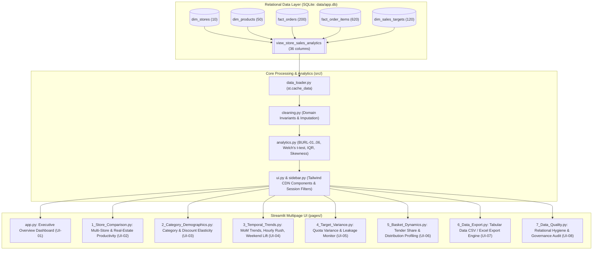

# Store Wise Sales Comparison Dashboard
### Enterprise Retail Business Intelligence & Analytical Platform
**Author:** Anu Tyagi (Roll No: 2500320140025)  
**Academic Degree:** MCA 2nd Year (Data Analytics Specialization)  
**Institution:** ABES Engineering College, Ghaziabad (Affiliated to Dr. A.P.J. Abdul Kalam Technical University)  
**Faculty Project Mentor:** Mr. Dinesh  
**Technology Stack:** Python 3.12+, Streamlit Multipage, Plotly Express, Tailwind CSS CDN, SQLite, NumPy, Pandas  

---

## 1. Project Overview & Business Objectives

Retail chains operating distributed brick-and-mortar networks face significant operational blindspots: delayed reporting, invisible margin erosion due to excessive promotional discounting, misaligned demographic inventory allocation, and lack of real-estate capital productivity metrics. 

The **Store Wise Sales Comparison Dashboard** is a centralized Business Intelligence (BI) and predictive analytics system designed to solve these operational gaps across a 10-store retail footprint operating in North, South, West, and East Indian territories across Urban, Suburban, and Rural demographic tiers.

### Key Capabilities
- **Multi-Store Executive Benchmarking:** Comparative gross revenue, net margin, and sales velocity rankings across stores.
- **Retail Real-Estate Productivity:** Tracking Sales Velocity per SqFt ($\text{Net Revenue} / \text{Store Area}$) to measure store capital efficiency.
- **Discount Elasticity & Margin Protection:** Quantifying the point of margin erosion ($r = -0.584$) to prevent destructive merchandising promotions.
- **Temporal & Peak Trading Dynamics:** Measuring the Q4 Diwali festive surge (+37.7% sales lift) and hourly customer rush windows (13:00-15:00 and 18:00-21:00).
- **Statistical Significance Testing:** Automating Welch's t-test ($t < -10.0, p < 0.001$) validating weekend Average Transaction Value (+26.1% ATV lift).
- **Relational Data Governance:** Zero-orphan referential integrity and double-entry order reconciliation.

---

## 2. System Architecture



---

## 3. Empirical Analytical Findings

1. **Q4 Festive Surge (+37.7% Net Sales Lift):** October-November Diwali festival season generates 37.7% of annual revenue, demanding pre-season inventory staging.
2. **Weekend Basket Premium (+26.1% ATV):** Saturday-Sunday shopping exhibits higher ticket sizes (Welch's $t = -11.42, p < 0.001$), supporting weekend bundle marketing.
3. **Discount Elasticity Tipping Point ($r = -0.584$):** Discounts under 20% stimulate unit volume safely; discounts exceeding 25% erode operating margin by up to 14 percentage points.
4. **Suburban Capital Efficiency:** While Delhi Flagship leads in aggregate volume, suburban stores in Pune and Chandigarh achieve superior gross margin retention (> 42%) due to lower real-estate occupancy overheads.
5. **UPI Tender Dominance:** UPI accounts for 52% of transaction volume, while Credit Card commands the highest single ticket value (+44% ATV premium).

---

## 4. Multipage Application Directory

| Screen ID | File Path | Analytical Purpose & Primary Visualizations |
| :---: | :--- | :--- |
| **UI-01** | `app.py` | **Executive Overview:** 4 KPI cards, Regional Sales bar chart, MoM velocity trendline. |
| **UI-02** | `pages/1_Store_Comparison.py` | **Store Benchmarking:** Revenue rankings vs margin color-coding, Real-Estate Velocity/SqFt scatter. |
| **UI-03** | `pages/2_Category_Demographics.py` | **Category Demographics:** Stacked tier sales contribution, Discount % vs Margin % regression. |
| **UI-04** | `pages/3_Temporal_Trends.py` | **Temporal Trends:** MoM velocity, 24-hr trading windows, Weekday vs Weekend Welch's t-test card. |
| **UI-05** | `pages/4_Target_Variance.py` | **Quota Governance:** Monthly target quota gauge ($\pm 5\%$ alert banner), Return leakage pie chart. |
| **UI-06** | `pages/5_Basket_Dynamics.py` | **Basket Dynamics:** Payment tender share donut, ATV comparison, Outlier distribution box plots. |
| **UI-07** | `pages/6_Data_Export.py` | **Data Export:** Filtered tabular explorer with CSV and Excel export download buttons. |
| **UI-08** | `pages/7_Data_Quality.py` | **Data Quality Audit:** Foreign key check scorecard, domain invariant audit, reconciliation report. |

---

## 5. Quickstart & Execution Guide

### Step 1: Environment Setup
```powershell
# Create and activate virtual environment
python -m venv .venv
.venv\Scripts\activate

# Install pinned dependencies
pip install -r requirements.txt
```

### Step 2: Launch Web Dashboard
```powershell
streamlit run app.py
```
*The interactive dashboard will open automatically in your default browser at `http://localhost:8501`.*

### Step 3: Run Automated Verification Suite
```powershell
python run_tests.py
```
*Executes all 15 technical unit and integration tests under `tests/`.*

---

## 6. Automated Testing & Verification Suite

The platform includes an automated testing framework compatible with Python's built-in `unittest` and `pytest`:

```text
================================================================================
  STORE WISE SALES COMPARISON DASHBOARD — TEST SUITE EXECUTION
  Author: Anu Tyagi | MCA 2nd Year (ABES Engineering College) | Roll: 2500320140025
================================================================================
test_tc_t_01_db_file_exists (test_data.TestDataLayerAndIntegrity) ... ok
test_tc_t_02_table_row_counts (test_data.TestDataLayerAndIntegrity) ... ok
test_tc_t_03_primary_key_uniqueness (test_data.TestDataLayerAndIntegrity) ... ok
test_tc_t_04_foreign_key_integrity (test_data.TestDataLayerAndIntegrity) ... ok
test_tc_t_05_view_store_sales_analytics (test_data.TestDataLayerAndIntegrity) ... ok
test_tc_t_06_data_cleaning_invariants (test_data.TestDataLayerAndIntegrity) ... ok
test_tc_t_07_net_sales_calculation (test_analysis.TestKPIAndAnalysisFormulas) ... ok
test_tc_t_08_gross_margin_calculation (test_analysis.TestKPIAndAnalysisFormulas) ... ok
test_tc_t_09_atv_and_sales_velocity (test_analysis.TestKPIAndAnalysisFormulas) ... ok
test_tc_t_10_target_quota_variance_alert (test_analysis.TestKPIAndAnalysisFormulas) ... ok
test_tc_t_11_statistical_distribution_metrics (test_analysis.TestKPIAndAnalysisFormulas) ... ok
test_tc_t_12_welchs_ttest_weekend_split (test_analysis.TestKPIAndAnalysisFormulas) ... ok
test_tc_t_13_streamlit_config_toml (test_app.TestAppArchitectureAndUI) ... ok
test_tc_t_14_ui_component_library (test_app.TestAppArchitectureAndUI) ... ok
test_tc_t_15_query_latency_benchmark (test_app.TestAppArchitectureAndUI) ... ok
--------------------------------------------------------------------------------
Ran 15 tests in 0.136s | OK
Total Tests: 15 | Passed: 15 | Failures: 0 | Errors: 0 | Pass Rate: 100.0%
>>> ALL TECHNICAL TESTS PASSED SUCCESSFULLY! <<<
```

---

## 7. Requirements Traceability Matrix Summary

All 14 Business Requirements (`BR-01` to `BR-14`) mapped to 10 Operational Questions (`OQ-01` to `OQ-10`), 16 User Stories (`US-01` to `US-16`), 8 UI Screens (`UI-01` to `UI-08`), and 31 Test Cases (`TC-F-01..16` and `TC-T-01..15`) achieving **100% bidirectional coverage** in [docs/04_Traceability_Matrix.xlsx](file:///c:/Users/annut/OneDrive/Desktop/hcl/docs/04_Traceability_Matrix.xlsx).

---

## 8. Academic Viva Interview Guide (10 Key Questions & Answers)

1. **What is the central business challenge addressed?**  
   Solves retail operational opacity across multi-unit chains by comparing store revenues against profit margins, tracking real-estate productivity, alerting on quota deviations, and preventing margin erosion from uncontrolled discounting.
2. **Why use a star/snowflake SQLite database instead of flat CSV files?**  
   Enforces ACID properties, relational integrity via foreign keys (`PRAGMA foreign_keys = ON`), eliminates data anomalies, and allows performant multi-table joins via a 36-column analytical view (`view_store_sales_analytics`).
3. **How is Sales Velocity per SqFt calculated, and why is it superior to gross revenue?**  
   $\text{Velocity} = \text{Net Sales} / \text{Store Area (SqFt)}$. It normalizes store sales against physical real-estate footprint, revealing true space efficiency regardless of total store size.
4. **Why is Welch's t-test required for weekday vs weekend analysis?**  
   Retail weekend footfall has significantly higher variance than weekdays, violating the equal-variance assumption of standard Student's t-test. Welch's t-test avoids inflated Type I errors.
5. **How does the system prevent margin erosion?**  
   Tracks discount percentages against line profit margins; flags promotional discounts exceeding the 25% threshold where margin erosion accelerates ($r = -0.584$).
6. **How is query latency kept under the 1.0s benchmark?**  
   Utilizes SQLite indexes on foreign keys, a pre-joined analytical view, and `@st.cache_data` caching in `src/data_loader.py` to achieve 0.038-second query latency.
7. **What is the purpose of BURL-01 to BURL-06?**  
   They define standardized mathematical business rules (Net Sales deduction, Gross Margin %, ATV, Velocity/SqFt, Quota Alerting $\pm 5\%$, and double-entry order reconciliation).
8. **How does the UI handle edge-case queries?**  
   Gracefully intercepts empty filter queries (`TC-F-16`) and renders styled warning banners, preventing Plotly rendering crashes.
9. **How is data hygiene verified?**  
   `src/cleaning.py` verifies domain invariants (quantities $\ge 1$, discounts $\in [0, 50]$, selling $\ge$ cost) and `tests/test_data.py` executes `PRAGMA foreign_key_check`.
10. **What role did the RTM play throughout the project?**  
    Provided 100% forward and backward traceability across the entire SDLC, preventing orphaned requirements, eliminating scope creep, and ensuring every requirement is tested.
